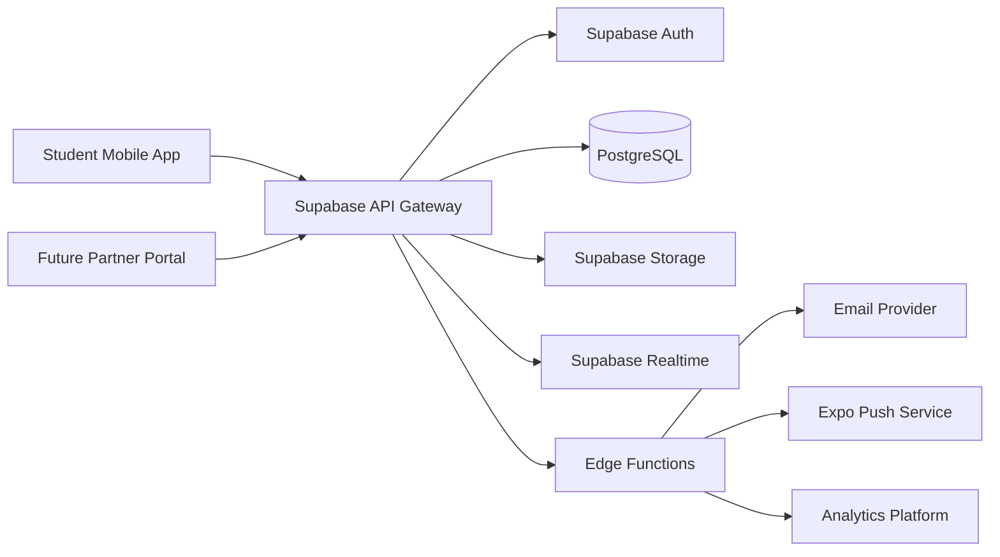
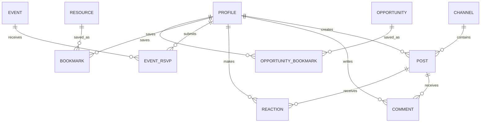
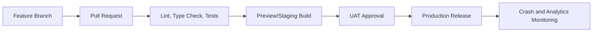

# Eben Institute Mobile Application Architecture

**Document purpose:** Define the end-to-end architecture for a scalable mobile ecosystem that connects African students to communities, educational resources, events, opportunities, mentors, and institutional programmes.

**Product position:** A student-centred educational and community platform aligned with Eben Institute's mission to develop academically excellent, financially literate, culturally rooted, and socially responsible African students.

---

## 1. Architecture Goals

The architecture must:

1. Deliver a focused MVP quickly without locking the product into a throwaway technical foundation.
2. Support Android first while remaining ready for iOS distribution.
3. Work acceptably on unstable and low-bandwidth mobile networks.
4. protect private user data and institution-owned learning materials.
5. support community moderation.
6. allow gradual expansion into mentorship, scholarships, quizzes, rewards, localisation, advanced content protection, and blockchain-based provenance.
7. keep infrastructure and operational costs proportionate to early adoption.

## 2. Product Scope by Release

### 2.1 MVP

The MVP validates whether students will repeatedly use a single platform for community participation, learning resources, events, and opportunities.

Core MVP modules:

- Authentication and onboarding
- Student profile
- Community channels and posts
- Comments, reactions, reporting, and basic moderation
- Digital library with articles, documents, videos, and external links
- Resource search and filtering
- Events and programmes
- RSVP and attendance status
- Opportunities board for scholarships, internships, competitions, and programmes
- Push and in-app notifications
- Basic analytics and audit logs

### 2.2 Post-MVP

- Direct messaging and group messaging
- Mentor profiles, matching, and booking
- Business and innovator profiles
- Quizzes, contests, points, badges, and leaderboards
- Scholarship application workflows
- Downloadable certificates
- Offline resource downloads
- Multilingual subtitles and localisation
- Institution and partner portals
- Advanced plagiarism deterrence and content watermarking
- Donations, sponsorships, subscriptions, and paid programmes
- Blockchain-based proof of authorship or content provenance

## 3. Recommended Technology Stack

### Mobile client

- **Framework:** React Native with Expo and TypeScript
- **Navigation:** Expo Router
- **State:** Zustand for local application state
- **Server state:** TanStack Query
- **Forms:** React Hook Form and Zod
- **UI:** NativeWind or a controlled design-token system
- **Secure local storage:** Expo SecureStore
- **Notifications:** Expo Notifications backed by FCM/APNs
- **Media:** Expo Image and Expo AV/video integration
- **Error monitoring:** Sentry

### Backend platform

- **Primary platform:** Supabase
- **Database:** PostgreSQL
- **Authentication:** Supabase Auth
- **File storage:** Supabase Storage
- **Realtime:** Supabase Realtime for selected community updates
- **Server-side functions:** Supabase Edge Functions
- **Authorization:** PostgreSQL Row-Level Security
- **Scheduled work:** Supabase Cron/pg_cron or an external scheduler when required

### Supporting services

- **Transactional email:** Resend or Postmark
- **Push delivery:** Expo Push Service initially
- **Product analytics:** PostHog or Firebase Analytics
- **Content delivery:** Supabase Storage CDN; Cloudflare can be added later
- **CI/CD:** GitHub Actions with Expo EAS Build and managed web deployment

## 4. High-Level System Context



## 5. Mobile Application Architecture

Use a feature-oriented architecture so each business domain owns its screens, components, state, validation, and service layer.

```text
apps/mobile/
  app/
    (auth)/
      welcome.tsx
      sign-in.tsx
      sign-up.tsx
      verify-email.tsx
      forgot-password.tsx
    (onboarding)/
      profile.tsx
      interests.tsx
      institution.tsx
    (tabs)/
      home.tsx
      community.tsx
      library.tsx
      opportunities.tsx
      profile.tsx
    community/
      channel/[channelId].tsx
      post/[postId].tsx
      create-post.tsx
    library/
      resource/[resourceId].tsx
    events/
      index.tsx
      [eventId].tsx
    opportunities/
      [opportunityId].tsx
    notifications.tsx
    settings.tsx
  src/
    components/
    features/
      auth/
      onboarding/
      profiles/
      community/
      library/
      events/
      opportunities/
      notifications/
      moderation/
    services/
      supabase/
      analytics/
      notifications/
    hooks/
    store/
    theme/
    types/
    utils/
    validation/
```

### Layer responsibilities

- **Presentation:** Screens, navigation, reusable UI components, loading states, empty states, and accessibility.
- **Feature/application:** Use cases such as publish post, RSVP to event, bookmark resource, and report content.
- **Data access:** Supabase queries, storage uploads, RPC calls, and Edge Function invocation.
- **Platform services:** Secure storage, notifications, analytics, deep links, network awareness, and crash reporting.

Direct database calls must be isolated behind typed feature repositories rather than scattered through screen components.

## 6. Core Domain Modules

### 6.1 Identity and onboarding

Responsibilities:

- Email/password authentication
- Email verification
- Password reset
- Session refresh
- Terms and privacy consent
- Student onboarding
- Institution, programme, level, interests, skills, and location capture
- Account deactivation and deletion request

Roles:

- `student`
- `content_creator`
- `moderator`
- `programme_manager`

### 6.2 Profiles

Student profile fields:

- Full name
- Profile image
- Biography
- Country, state, and city
- Institution and faculty/department
- Programme and study level
- Skills and interests
- Portfolio and professional links
- Visibility settings
- Earned badges in later releases

Profiles should not expose private contact information by default.

### 6.3 Community

MVP community model:

- Predefined channels
- Text and media posts
- Comments
- Reactions
- Pinned posts
- Saved posts
- Reports
- Moderation status

For MVP, use feed-style channel discussions rather than full socket-based Discord-style chat. This reduces moderation, synchronization, and infrastructure complexity while still validating community engagement.

Realtime subscriptions may update new posts and comments, but PostgreSQL remains the source of truth.

### 6.4 Digital library

Content types:

- Article
- PDF/document
- Video
- Audio/podcast
- External resource

Capabilities:

- Categories and tags
- Academic and entrepreneurial tracks
- Search and filtering
- Featured resources
- Bookmarks
- View/open tracking
- Author attribution
- Publishing workflow
- Optional signed URLs for restricted files

MVP content protection should use authentication, private buckets where appropriate, signed URLs, visible attribution, download controls where technically feasible, and audit logs. It must not be marketed as absolute prevention of copying.

### 6.5 Events and programmes

Capabilities:

- Event listing and detail
- Online, physical, and hybrid formats
- Date, time, venue, meeting link, capacity, and organiser
- RSVP
- Add-to-calendar link
- Reminder notifications
- Attendance status

### 6.6 Opportunities

Opportunity types:

- Scholarship
- Internship
- Competition
- Hackathon
- Fellowship
- Grant
- Volunteer programme
- Conference

Capabilities:

- Eligibility and deadline
- Host organisation
- Country or remote status
- Application link
- Save/bookmark
- Deadline reminder
- Verification status

The MVP links users to external applications. Native application workflows are a later phase.

### 6.7 Notifications

Notification channels:

- In-app inbox
- Push notification
- Transactional email where necessary

Events that create notifications:

- Account verification
- New announcement
- Reply or reaction
- Upcoming RSVP event
- Saved opportunity approaching deadline
- New featured resource
- Moderation outcome

Users must control non-essential notification categories.

## 7. Data Architecture

### Principal tables

```text
profiles
institutions
user_interests
interests
roles
user_roles
channels
posts
post_media
comments
reactions
bookmarks
content_reports
moderation_actions
resources
resource_categories
resource_tags
resource_tag_links
resource_views
events
event_rsvps
opportunities
opportunity_categories
opportunity_bookmarks
notifications
notification_preferences
push_tokens
audit_logs
app_settings
```

### Selected relationships



### Data rules

- Use UUID primary keys.
- Store all timestamps in UTC.
- Add `created_at`, `updated_at`, and actor fields where relevant.
- Prefer soft deletion for moderated or recoverable records.
- Add database constraints rather than relying solely on UI validation.
- Use cursor pagination for feeds and large lists.
- Add full-text or trigram search indexes for resources and opportunities.

## 8. Authorization and Row-Level Security

Examples:

- Users can read published public content.
- Users can create posts only in channels available to their role.
- Users can edit or delete their own content subject to moderation rules.
- Moderators can act only within assigned moderation capabilities.
- Only content managers can publish library resources, events, and opportunities.
- Service-role credentials must never be bundled into the mobile app.
- Sensitive actions must run through Edge Functions or protected database functions.

Each table must have explicit RLS policies before production data is introduced.

## 9. API and Service Design

Most CRUD operations can use Supabase's generated API through typed repositories. Use Edge Functions for:

- Notification fan-out
- Transactional email
- File access policy enforcement
- Report resolution workflows
- Analytics aggregation
- Scheduled reminders
- Account deletion orchestration
- Third-party webhooks

Example logical endpoints:

```text
POST /functions/v1/publish-post
POST /functions/v1/report-content
POST /functions/v1/event-reminders
POST /functions/v1/opportunity-reminders
POST /functions/v1/account/delete
```

All functions should validate JWTs, roles, payload schemas, rate limits, and idempotency where relevant.

## 10. Realtime Strategy

Use realtime selectively for:

- New posts in an open channel
- New comments on an open post
- Notification inbox updates

Do not subscribe the app to every table. Unsubscribe inactive screens and refetch authoritative data after reconnecting.

Direct messaging should be deferred until its privacy, blocking, abuse prevention, delivery state, and retention requirements are designed.

## 11. Offline and Low-Bandwidth Strategy

- Cache recent feeds, resources, events, and opportunities with TanStack Query persistence.
- Use optimistic updates only for low-risk actions such as reactions, saves, and RSVP toggles.
- Compress uploaded images and enforce upload limits.
- Serve responsive image sizes.
- Lazy-load media and avoid autoplay.
- Show connection state and retry controls.
- Queue safe actions for retry when connectivity returns.
- Keep primary navigation and previously viewed content usable offline where practical.

Full offline document downloads belong in a later release because of storage, rights, and revocation complexity.

## 12. Security Architecture

- Secure tokens with Expo SecureStore.
- Enforce email verification for contribution privileges.
- Use least-privilege RLS and database roles.
- Keep private files in non-public buckets and issue short-lived signed URLs.
- Validate MIME types and file sizes server-side.
- Scan uploads when operational scale justifies it.
- Apply rate limits to authentication, posting, commenting, reporting, and notification endpoints.
- Provide block, report, account deletion, and privacy controls.
- Redact sensitive data from logs and analytics.
- Rotate service credentials and isolate development, staging, and production environments.

## 13. Content Protection Approach

The deck requests IP-protected material sharing and plagiarism deterrence. The realistic architecture should combine:

1. authenticated access;
2. role- or membership-based permissions;
3. private storage and expiring signed URLs;
4. visible and optional user-specific watermarks;
5. attribution and rights metadata;
6. access logs;
7. reporting and takedown processes;
8. terms of use and copyright policy.

No mobile or web system can completely prevent screenshots, recording, or authorised recipients from redistributing content. Blockchain integration may later prove provenance, but it does not prevent copying.

## 14. Notification Architecture

Store notification records before sending push messages so delivery failure does not remove the in-app record.

## 15. Analytics and Impact Measurement

Product metrics:

- Onboarding completion
- Weekly and monthly active users
- Community contributors and readers
- Post/comment/reaction rates
- Resource opens, completions, and bookmarks
- Event views and RSVPs
- Opportunity opens and outbound applications
- Notification engagement
- Retention by institution and interest

Institutional impact indicators:

- Students reached
- Institutions represented
- Learning resources distributed
- Programme participation
- Opportunities shared
- Mentorship participation in later releases
- Documented student outcomes

Collect only metrics that have a defined decision or reporting purpose.

## 16. Environments and Deployment

### Environments

- Local development
- Shared development
- Staging/UAT
- Production

Each environment should use separate Supabase projects, secrets, storage, analytics properties, and notification credentials.

### CI/CD pipeline



Recommended controls:

- Protected main branch
- Mandatory pull request review
- Automated linting and type checking
- Unit and integration tests
- Database migrations committed to source control
- EAS development, preview, and production profiles
- Staged Android rollout before full release

## 17. Testing Strategy

- **Unit tests:** validation, formatters, permissions helpers, repositories, and state logic.
- **Component tests:** forms, cards, error states, and permission-sensitive UI.
- **Integration tests:** authentication, database policies, storage uploads, RSVP, reporting, and notification creation.
- **End-to-end tests:** onboarding, publishing a post, finding a resource, RSVP, saving an opportunity, and moderator resolution.
- **Security tests:** RLS policy tests, privilege escalation attempts, file access, rate limiting, and secret scanning.
- **Device tests:** representative low-end Android devices, screen sizes, network throttling, and interrupted sessions.

## 18. Scalability Plan

### Early stage

Supabase managed services, indexed PostgreSQL, paginated feeds, compressed media, and limited realtime subscriptions should be sufficient.

### Growth stage

- Add dedicated search such as Typesense, Meilisearch, or Algolia when PostgreSQL search becomes insufficient.
- Add queues for large notification and media jobs.
- Add CDN and image transformation controls.
- Partition high-volume audit or activity data when necessary.
- Introduce read models/materialized views for analytics-heavy dashboards.
- Separate high-volume chat or media workloads only when usage data justifies it.

## 19. Architecture Decisions

### React Native with Expo

Chosen because it supports Android and iOS from one TypeScript codebase, shortens release setup, and works well with the existing React prototype.

### Supabase

Chosen for managed authentication, PostgreSQL, storage, realtime, and serverless functions with low initial operational burden.

### Feed-based community before full chat

Chosen because it better supports thoughtful discussions, moderation, search, and asynchronous student communities while reducing MVP complexity.

### Blockchain deferred

Chosen because the pitch deck places blockchain in Phase 5 and because community adoption, content quality, and programme usage must be proven before adding distributed-ledger complexity.

## 20. MVP Acceptance Architecture

The MVP architecture is acceptable when:

- A verified student can create and complete a profile.
- The user can browse channels, publish posts, comment, react, save, and report.
- The user can browse and search published learning resources.
- The user can browse events and submit or cancel an RSVP.
- The user can browse and save verified opportunities.
- The user receives in-app and push notifications for configured events.
- RLS tests prove users cannot access or mutate unauthorised records.
- The app handles loading, empty, offline, validation, and error states.
- Production builds can be generated through a repeatable CI/CD process.

## 21. Future Extension Map

| Future capability      | Architectural extension                                        |
| ---------------------- | -------------------------------------------------------------- |
| Mentorship             | Mentor profiles, availability, matching, sessions, reviews     |
| Scholarships           | Application forms, documents, reviewer workflow, scoring       |
| Quizzes and contests   | Question bank, attempts, scoring, anti-cheat controls          |
| Rewards                | Points ledger, badge rules, redemption and fraud controls      |
| Localisation           | Translation keys, locale content, subtitle tracks              |
| Business profiles      | Organisation model, team roles, portfolios, listings           |
| Paid programmes        | Payment provider, orders, receipts, refunds, entitlements      |
| Advanced IP protection | Per-user watermark jobs, rights policies, takedown workflow    |
| Blockchain provenance  | Content hashes, wallets, chain adapter, provenance viewer      |
| Continental scale      | Multi-country configuration, moderation regions, data policies |

---

## 22. Recommended MVP Boundary

The first release should not attempt to implement every item in the institutional vision. Its job is to prove that students will join, find relevant educational or career value, and return for community activity.

The recommended MVP therefore consists of:

1. student onboarding and profiles;
2. moderated community feeds;
3. digital resource library;
4. events and RSVP;
5. opportunities board;
6. notifications;
7. analytics, auditability, and a secure backend foundation.

This boundary turns the existing visual prototype into a credible first product while preserving a clear route to the wider Eben Ecosystem.
